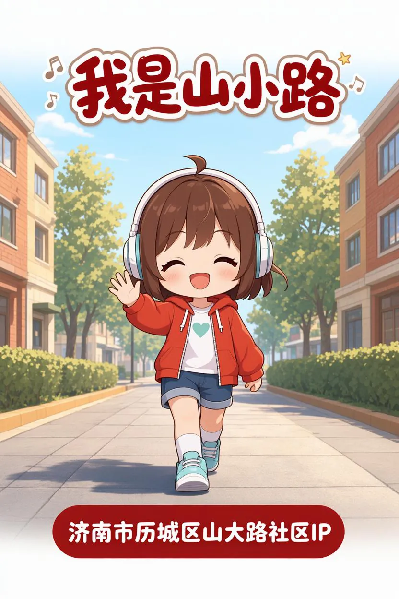
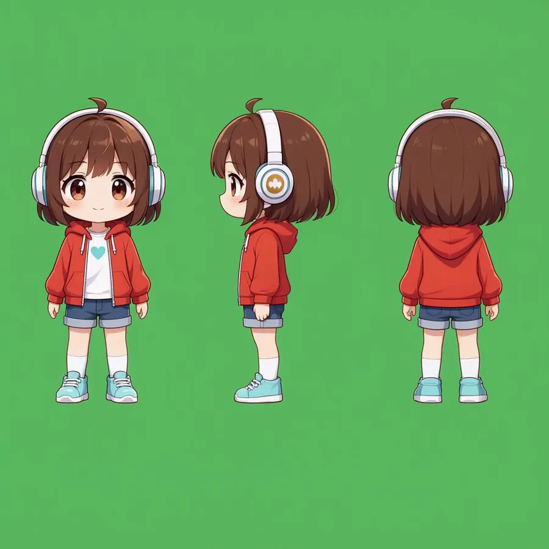
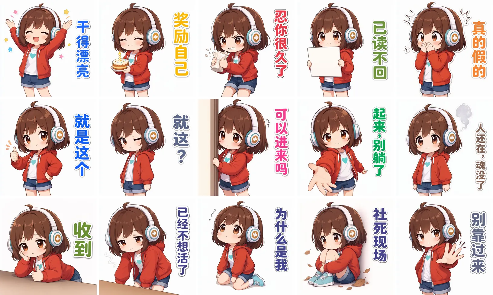
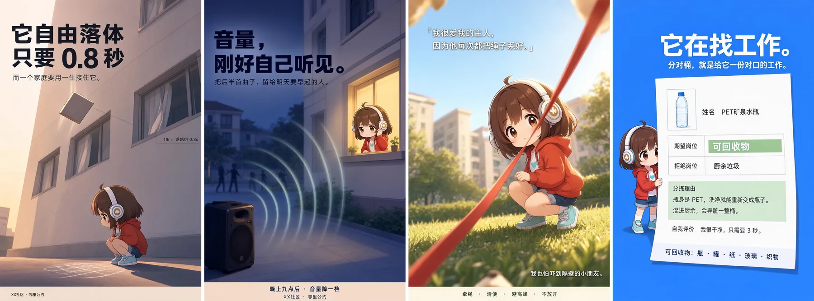
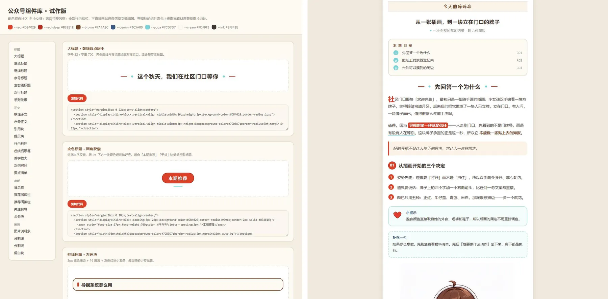
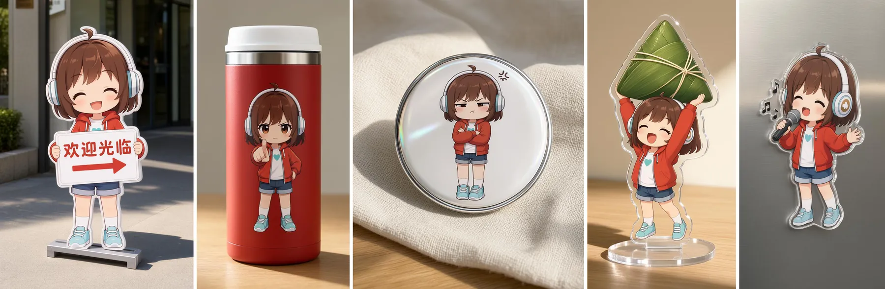
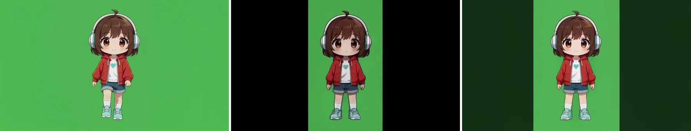

# david-ip-production

> **An agent skill that turns one character into a full visual asset set.**
> Character sheet → turnaround → key visual → stickers / posters / WeChat article components / merchandise mockups / video frames, with the character held consistent by a single identity anchor.
> Cloud model thinks, local model draws. Built and battle-tested on a low-cost laptop GPU.

**一句话**：把「一个 IP 从零到全套视觉资产」的工序，封装成一句指令就能跑的 Agent Skill，并用三视图把角色形象锁死。

[](LICENSE)
[](NOTICE.md)
[](#技术架构云端负责理解本地负责生产)



---

## 它解决什么问题

想做 IP 的人很多，能做出**成套**视觉资产的人很少。卡点不在审美，而在四堵墙：

| 墙 | 具体表现 |
| --- | --- |
| 技术门槛 | 会写一句提示词，但不知道三视图、参考图、局部重绘该怎么串 |
| 算力成本 | 按次计费的在线服务，一整套资产试错几十次就烧完了 |
| 角色一致性 | 换个场景、换个动作，同一角色就「不像了」 |
| 产出不稳定 | 没有审核节点，一次生成全身，返工全靠运气 |

目标读者是**不具备大规模 AI 或手工设计能力的个人与基层团队**：基层文旅、社区党建与活动宣传、中小学宣传栏和校园文化活动。

本 Skill 的目标很窄：**低门槛、低成本、轻量化**——必要时把生成放到本地，减轻算力成本。

## 它是什么，不是什么

**是**「工序约束」。它不给模型加能力，而是把专业交付流程变成模型必须停下来的检查点：先定资产、先出方案、先审小样、批量必须差异化。

**不是**「生成模型」，也**不保证**消除幻觉。它降低的是流程性翻车（形象漂移、方案空转、出了才发现全组不像一个人），不是把审图这件事交出去。文字、手部、品牌元素、风格归属仍需人工逐张看。

## 生产流水线

```
概念确立 ──► 白底人设图 ──► 三视图 ──► 主视觉 ──┬─► 表情包
   (P-1)        (P-2)        (P-3)     (P-4)   ├─► 创意海报
                                                ├─► 公众号推文组件
                                                ├─► 文创概念图
                                                └─► 视频素材
```

**关键在于中间那一步**：三视图是一份「形象说明书」，正／侧／背把发型、配饰、配色、比例一次性钉死。此后所有产物都以三视图为参考图做图生图，而不是重新描述一遍角色——这是角色一致性能成立的原因。

`P-2 → P-3 → P-4` 严格串行，不得并行；三视图没定稿，不进下游。

## 五条硬规则

| 规则 | 内容 | 为什么 |
| --- | --- | --- |
| **G-1 资产锚定** | 白底人设图、三视图、主视觉、配色板、字体规范，缺项不得进入下游 | 没有锚点的产出无法互相对齐 |
| **G-2 三视图优先** | 除用户另有明确要求，全部图像／视频以三视图为参考图 | 一致性只来自同一张锚点，不来自同一段文字 |
| **G-3 方案先行** | 每个板块的维度全部确定后才允许生成 | 维度没定就生成，等于用废图代替讨论 |
| **G-4 分批审核** | 方案确认 → 小样试做 → 全量生成，不得跳级 | 一张小样的成本远低于十二条返工 |
| **G-5 批量多样性** | 任意两件作品至少在两个维度上不同 | 一批海报长成一张海报的十次复制，是批量生成最常见的失败 |

## 六个产出板块

| 板块 | 生成前必须确定的维度 | 产出特征 |
| --- | --- | --- |
| 主视觉 / 角色资产 | 概念特征 · 人设图规格 · 三视图规格 · 主视觉表达方向 | 全套资产的源头 |
| 表情包 | 固定形象 · 动作神态 · 简短配字 · 字体与颜色 · 构图规范 | 一组 12–16 枚，构图全批统一 |
| 海报 | 核心灵感 · 画面方案 · 主配色 | 单张成品，强叙事 |
| 公众号推文 | 配色方案 · 组件清单 · icon 清单 · 内容文案 | HTML/CSS 组件 + 本地预览页 |
| 文创 | 动作与形态 · 产品形态 · 配色方案 · 应用场景 · 产品类型 | 先平面底图，再实物概念图 |
| 视频 | 动作与行为 · 主题内容 · 时长 | 图生视频；可出绿幕素材 |

具体流程、维度定义和提示词范式在 [`references/`](references/) 里，Agent 按任务只加载需要的那一份，不预读全部产线。

## 快速开始

### 1. 放进你的 skills 目录

```bash
git clone <this-repo> david-ip-production
```

| Agent | 目标路径 |
| --- | --- |
| Reasonix | `%APPDATA%\reasonix\skills\david-ip-production`（macOS/Linux：`~/.config/reasonix/skills/`） |
| Claude Code | `~/.claude/skills/david-ip-production` |
| Codex | `~/.codex/skills/david-ip-production` |

目录名保留 `david-ip-production`，与 `SKILL.md` 里的 `name` 一致；`agents/openai.yaml` 供支持该清单的运行时读取。详见 [`docs/install.md`](docs/install.md)。

### 2. 触发

```
用 david-ip-production 从零做一个社区 IP：
主题是社区食堂，风格可爱、年轻化，先出概念特征清单。
```

也可以直接用板块名起手：`做一组表情包`、`出一套推文组件`、`做文创概念图`。Skill 会先补齐该板块缺失的维度，再要你确认，然后才生成。

### 3. 首次使用的建议顺序

1. **概念 + 人设图**：先把「这个 IP 是谁」说清楚，拿到白底正面全身图。
2. **三视图**：定稿，此后不要再改；改一次等于全组重做。
3. **主视觉**：顺手把配色板与字体气质提取出来。
4. **再挑一个板块试水**（推荐表情包，改动成本最低）。
5. 其余板块按需延展。

## 案例：山小路

济南市历城区山大路街道的社区 IP。设计判断：**用红色建立识别锚点**，可爱、运动、年轻化的动漫风格，降低年龄、性别与理解门槛。

<table>
<tr>
<td width="50%"><br><sub>三视图 / IDENTITY ANCHOR —— 正·侧·背，形象唯一技术锚点</sub></td>
<td width="50%"><br><sub>主视觉 / KEY VISUAL —— 建立认知，一套配色与字体气质随之落定</sub></td>
</tr>
</table>

**表情包（15 枚，同一构图规范、同一配字逻辑）**



**创意海报（社区公益四则：高空抛物、夜间噪音、文明养犬、垃圾分类）**



**公众号推文组件（左：组件库试作版；右：用这些组件排出来的文章页）**



**文创概念图（立牌、保温杯、徽章、亚克力、贴纸）**



**视频素材（绿幕，人物居中，可直接叠进实拍）**



同一套 Skill 换一个角色（某中学的校园吉祥物）也能在一小时内跑出表情包、海报与视频素材——**资产链是通用的，换的只是三视图**。

## 技术架构：云端负责理解，本地负责生产

| | 云端语言模型 | 本地生成模型 |
| --- | --- | --- |
| 长处 | 理解需求、拆解任务、写脚本与提示词 | 直接吃本机算力，不按次计费、不外传素材 |
| 输入 | 需求 / 资料 / 约束 | 参考图 / 指令 / 工作流 |
| 输出 | 工作流、提示词、参数建议 | 可复用的 IP 资产文件 |

**主力生产模型：Qwen-Image 2.1**

- 7B 单流 DiT 视觉生成组件，文生图 / 指令编辑 / 局部重绘
- 最多 **10 张**参考图（多图参考是整套流程能跑通的基础）
- 文本编码器 Qwen3-VL-8B，64 通道 RGBA VAE
- 常用稳定尺寸 1024²–1328²；Base 25 步 / Turbo 8 步 / CFG 1.0

**在低配机器上的真实账本**（RTX 5060 laptop，8GB 显存，CUDA 核心 3328，FP16 15.87 TFLOPS）：

- 1K 直出约 **40 秒**，参考图生图约 **60 秒**
- 不按次计费，成本＝设备 + 用电 + 时间；素材不出本机

**编排环境：ComfyUI**

`输入（Checkpoint / 编码器 / VAE / 参考图 / 遮罩） → 节点图（编码 → 采样 → 解码） → 输出（图像 / 视频，PNG 内嵌工作流，JSON / API 工作流）`。参数可复现、工作流可保存复用，社区成熟工作流可直接取用。

> 本地部署的边界也要说清：仍需设备、时间和学习成本，结果质量同样需要检查与迭代。它的价值在于**让试错变得可持续**，而不是让质量自动变好。

## 本地生图（可选）

Skill 默认只做提示词与流程编排；只有当你明确说「我需要本地生图」时，它才会去读你的本地手册。仓库不内置任何手册正文，`SKILL.md` 里留的是占位符：

```text
<your-local-generation-manual>
```

首次使用请替换为你自己的 ComfyUI + Qwen-Image 2.1 手册路径，登记方式见 [`docs/install.md`](docs/install.md)。

## 仓库结构

```
david-ip-production/
├─ SKILL.md                 # 行为准则 v1.1：G-1~G-5、板块路由、条件读取
├─ references/
│  ├─ character-assets.md   # P-1~P-4 主视觉体系与角色资产
│  ├─ stickers.md           # E-1~E-3 表情包（含完整提示词案例）
│  ├─ posters.md            # H-1~H-3 海报
│  ├─ wechat-articles.md    # W-1~W-5 公众号推文组件
│  ├─ merchandise.md        # C-1~C-4 文创
│  └─ videos.md             # V-1~V-2 视频
├─ agents/openai.yaml       # 运行时清单元数据
├─ assets/                  # 案例图（CC BY-NC 4.0，见 NOTICE.md）
└─ docs/install.md          # 安装与本地生图登记
```

## 边界与注意

- **需要维护**：模型、工作流、平台的可用性都会变；规则也需要随实践更新。本 Skill 不保证消除幻觉。
- **形象一致性取决于三视图质量**：三视图模糊、多视角比例不一致，下游全部受影响。这一步值得多花时间。
- **生成结果必须人工审核**：中文字形、手部、文字排版、品牌元素、风格归属，逐张过。
- **不要用于侵权 IP**：他人角色形象、注册商标、影视动漫 IP 需获得授权；本 Skill 只管工序，不管授权。

## 许可

- 代码与文档：[MIT](LICENSE)
- `assets/` 下的案例图（山小路形象及其衍生）：[CC BY-NC 4.0](NOTICE.md) —— 可署名非商用转载，不得商用或训练商用模型。

---

<sub>IP Asset Production · Field Note / 2026.10 · SWISS STYLE / WHITE GROUND / IKB ANCHOR</sub>
